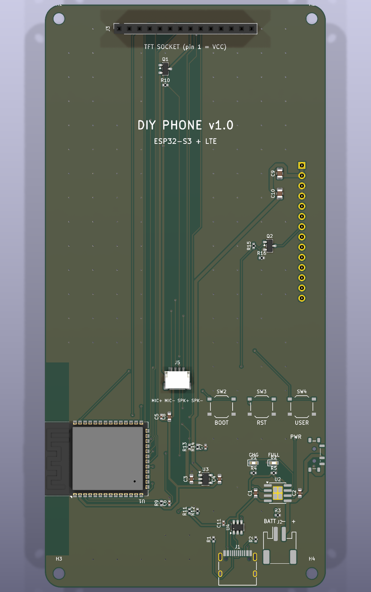
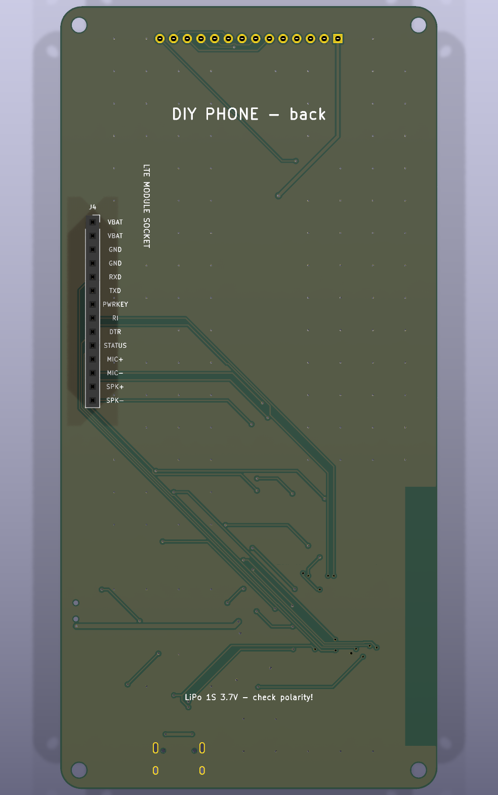

# DIY Phone: build your own phone with JLCPCB

An open-source, buildable mobile phone. You order the mainboard
from [JLCPCB](https://jlcpcb.com) already assembled, plug in a 2.8" touchscreen,
an LTE module and a LiPo battery, flash the firmware, and make calls and
send texts.

<p>


</p>

| | |
|---|---|
| Processor | ESP32-S3 (dual core 240 MHz, 16 MB flash, 8 MB PSRAM, Wi-Fi + BLE) |
| Cellular | plug-in LTE Cat-1 / Cat-4 module with VoLTE (SIMCom A7670 / SIM7600 or similar) |
| Display | 2.8" 240x320 ILI9341 TFT, resistive touch |
| Power | USB-C charging (1 A), 1S LiPo, power switch, battery + USB sensing |
| Audio | earpiece + microphone via the module's analog audio |
| PCB | 70 x 145 mm, 2 layers, all SMD parts on the front for JLCPCB economic assembly |

## Repository layout

```
hardware/
  phone_design.py        parts, nets and placement (single source of truth)
  build_board.py         generates the KiCad board, autoroutes, DRC, exports fab files
  check_parts.py         checks live JLCPCB stock for every part
  output/
    diy-phone.kicad_pcb  KiCad 9 board (open it to inspect or edit)
    jlcpcb/              gerbers.zip, bom.csv, cpl.csv  <- upload these to JLCPCB
firmware/                PlatformIO project for the ESP32-S3 (dialer, calls, SMS)
docs/
  ordering-on-jlcpcb.md  step-by-step ordering guide
  hardware.md            design notes, pinouts, power, module selection
```

## How to build one

1. **Order the board.** Follow [docs/ordering-on-jlcpcb.md](docs/ordering-on-jlcpcb.md):
   upload `gerbers.zip`, enable PCB assembly, then upload `bom.csv` and `cpl.csv`.
2. **Buy the plug-in parts:** display, LTE breakout + antenna, LiPo, earpiece/mic,
   2 pin sockets (list in the ordering guide).
3. **Choose an LTE module** your carrier supports for VoLTE voice calls
   ([docs/hardware.md](docs/hardware.md#why-a-plug-in-cellular-module)).
4. **Solder the two sockets**, flash the [firmware](firmware/README.md), and assemble.

## Status

This is a v1 design. It passes KiCad DRC with no errors and no unrouted
connections, and every part is in stock at JLCPCB. It has **not been
fabricated and tested yet**, so treat the first order as a prototype run:
order 5 bare PCBs with 2 assembled, and bring them up carefully (the
ordering guide has a power-on checklist). The PCB was autorouted. If you
know KiCad, it's worth opening the board and tidying the routing before
ordering.

The cellular part is a plug-in module on purpose: an on-board LTE modem
needs RF layout, antenna tuning and certification work, which is a sensible
v2 once the rest of the phone works.

## Safety

Lithium batteries can catch fire if shorted, reversed or over-charged.
Use a protected cell, check connector polarity, and don't leave a prototype
charging unattended.
